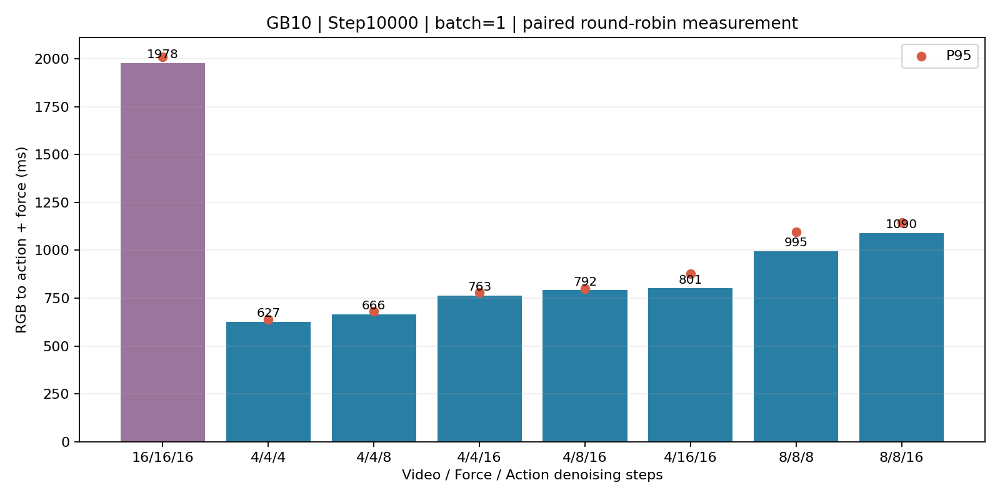
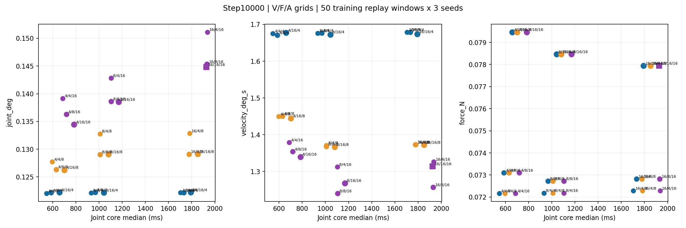
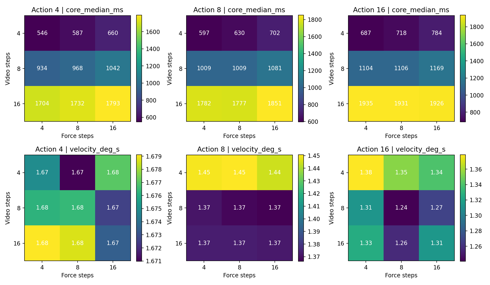
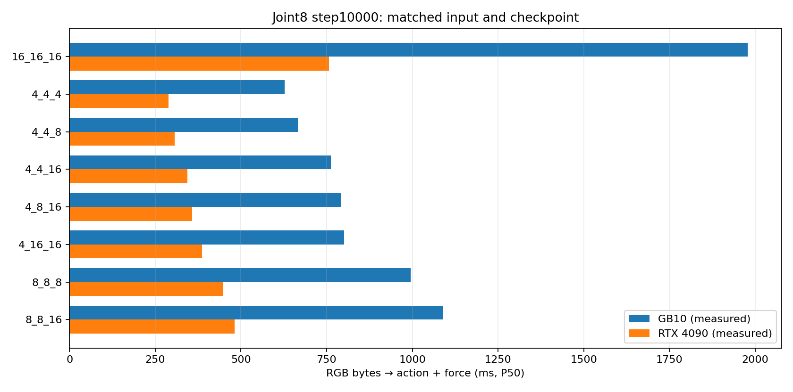

# joint8-20k / step10000 三专家采样与推理机评测

更新：2026-10-21。本机 step10000 采样评测与 4090 同输入延时对照均已完成；结论只适用于本报告列出的离线推理，不代表机械臂闭环成功率。

## 推荐

**优先真机验证 Video=4、Force=4、Action=16。** 本机 RGB→动作与力输出 P50 **762.7 ms**、P95 **779.0 ms**，对同组同次基线的配对速度比为 **2.62×**。97 个事件窗口上的关节误差较基线降低 2.4%，力误差降低 9.2%；动作速度差分误差增加 4.1%，二阶差分误差增加 4.8%。这是响应速度与离线轨迹误差的折中选择，不是已验证的成功率最优策略。

**8/8/16 作为优先保留轨迹质量的对照。** RGB 完整处理 P50 1090.1 ms，事件窗口速度差分误差降低 2.2%，二阶差分误差降低 2.2%，其他汇总误差也接近或低于基线。它在本机已接近或超过 32 点动作块的 1.067 s 覆盖时长，不适合据此承诺连续异步控制。

4/8/16 比 4/4/16 多约 29 ms，事件窗口关节、速度、夹爪误差稍小，而力误差稍大，可作为真机第三候选。4/4/8 的完整处理约 666 ms；4/4/4 最快约 627 ms，但事件窗口速度差分误差增加 23.3%、二阶差分误差增加 26.2%，因此不凭更小的位置 MAE 选它作唯一默认。

## 权重、数据与数值协议

- 训练任务 `job-0091e5fd-71df-4582-b5b0-fd272204bd9b`，joint8-20k SSD 续训任务，检查点 `step_010000.pt`，文件头 step=10000。
- SHA256 `2e8409d495d11961614b72d81b25bec7cc71bc2e194acb15ea220a72edace1d8`；模型约 28.24 亿参数；评测不改训练参数。
- V/F/A 依次为 **视频/力/动作**。基线三个专家各 16 步；4、8、16 的笛卡尔积 27 配置 × 50 midpoint 窗口 × 3 种子 = **4,050** 次预测。
- 额外按 GT 夹爪范围、力变化选取 **97** 个窗口，9 配置 × 3 种子 = **2,619** 次预测。共 **6,669** 次质量预测；另有 450 次视频解码质量评分与 330 组核心/RGB 配对时延样本。
- 所有 50 个 episode 都参与过训练。97 个窗口选自同一批 episode；不是训练留出集、成功抓取标注或独立的 97 个任务。配对 bootstrap 的单位为 episode，不能推断泛化能力。
- batch=1、BF16、224×448 双相机拼接；动作和力各 32 点、30 Hz。视频 9 帧含当前帧，未来 8 帧按 7.5 Hz 评分。种子 action/force/video = 42+s/43+s/44+s，s=0、1、2。
- 每个专家在自身 Euler 区间起点计算方向、区间终点更新状态。较少步专家在区间内保持状态和时钟，其逐层 K/V 可精确复用。Video 更新会触发 Action 所需的 Force 特征重算；名义 Force 积分步数不总等于 Force 前向次数。完整计数保存在 `report.json` 的 `runner_stats`。
- 这是多速率联合积分与固定状态特征复用；没有跨变化状态近似外推动作方向。所有组合通过完整模型独立参考实现校验，阈值为归一化 max≤0.05、mean≤0.01。该阈值仅用于实现一致性，不是物理质量阈值。

## 本机 GB10 时延实测

| V/F/A | 样本 n | 核心 P50/P95 ms | RGB→动作/力 P50/P95 ms | RGB 配对提速 |
|---|---|---|---|---|
| 16/16/16 | 120 | 1897/1929 | 1978/2011 | 1.00× |
| 4/4/4 | 30 | 540/554 | 627/638 | 3.18× |
| 4/4/8 | 30 | 583/592 | 666/680 | 2.99× |
| 4/4/16 | 30 | 680/692 | 763/779 | 2.62× |
| 4/8/16 | 30 | 706/718 | 792/798 | 2.52× |
| 4/16/16 | 30 | 723/812 | 801/878 | 2.35× |
| 8/8/8 | 30 | 919/1029 | 995/1096 | 1.86× |
| 8/8/16 | 30 | 1016/1070 | 1090/1146 | 1.70× |

核心时间包含前缀预填充、噪声、图输入复制与联合采样。RGB 路径从已解码双相机 RGB 开始，包含 resize、CPU→GPU、VAE、联合核心、GPU→CPU、动作/力反归一化。**不含相机采集、视频压缩解压、网络、机器人执行或生成视频解码。** VAE/图像前处理约 75–81 ms。

每次配对交替执行基线和最多两个候选，顺序按 repetition 轮转，30 次/候选；基线跨四组共 120 次。设备频率在测试中有变化，所以速度比采用同组同次的比值中位数，不直接将全局基线中位数除以每个候选。P95 为本次样本分位数，不是最大时延保证。

Torch 2.9.1+cu130 / ARM64 / GB10。已有编译缓存下的首次编译/捕获/预热约 1.75–7.57 s，单列在 `latency.json` 的 `setup_ms`，不是空缓存冷启动时间；不计入稳态。测量时同时保留多个候选图，PyTorch peak allocated 7.85–8.35 GiB、reserved 9.94–11.05 GiB，不代表单一部署实例最低显存。GB10 统一内存的 nvidia-smi memory=N/A 不能作为未用 GPU 的依据。

## 与录制 GT 的离线误差

50 个 midpoint 窗口：

| V/F/A | 关节 MAE ° | 夹爪 MAE | 速度差分 MAE °/s | 加速度差分 MAE °/s² | 力 MAE N | 力矩 MAE Nm |
|---|---|---|---|---|---|---|
| 16/16/16 | 0.1448 | 0.00284 | 1.314 | 63.53 | 0.0779 | 0.00492 |
| 4/4/4 | 0.1220 | 0.00278 | 1.675 | 83.37 | 0.0722 | 0.00474 |
| 4/4/8 | 0.1277 | 0.00232 | 1.450 | 71.77 | 0.0722 | 0.00474 |
| 4/4/16 | 0.1392 | 0.00274 | 1.379 | 67.11 | 0.0722 | 0.00474 |
| 4/8/16 | 0.1363 | 0.00274 | 1.354 | 65.85 | 0.0731 | 0.00477 |
| 4/16/16 | 0.1345 | 0.00269 | 1.340 | 64.96 | 0.0795 | 0.00496 |
| 8/8/8 | 0.1291 | 0.00257 | 1.368 | 67.03 | 0.0727 | 0.00473 |
| 8/8/16 | 0.1386 | 0.00277 | 1.241 | 59.89 | 0.0727 | 0.00473 |

97 个夹爪/力变化窗口：

| V/F/A | 关节 MAE ° | 夹爪 MAE | 速度差分 MAE °/s | 加速度差分 MAE °/s² | 力 MAE N | 力矩 MAE Nm |
|---|---|---|---|---|---|---|
| 16/16/16 | 0.1446 | 0.01289 | 1.415 | 67.79 | 0.0800 | 0.00556 |
| 4/4/4 | 0.1257 | 0.01240 | 1.745 | 85.61 | 0.0726 | 0.00529 |
| 4/4/8 | 0.1300 | 0.01235 | 1.555 | 75.79 | 0.0726 | 0.00529 |
| 4/4/16 | 0.1411 | 0.01299 | 1.473 | 71.06 | 0.0726 | 0.00529 |
| 4/8/16 | 0.1390 | 0.01284 | 1.464 | 70.61 | 0.0750 | 0.00532 |
| 4/16/16 | 0.1380 | 0.01295 | 1.438 | 69.33 | 0.0812 | 0.00555 |
| 8/8/8 | 0.1331 | 0.01252 | 1.535 | 74.79 | 0.0743 | 0.00534 |
| 8/8/16 | 0.1405 | 0.01284 | 1.384 | 66.31 | 0.0743 | 0.00534 |

所有数值为按有效目标数加权的 MAE；夹爪为归一到 [0,1] 的开合度。速度和加速度指标来自预测与 GT 的差分误差；它们并不直接证明机械稳定性。位置均值误差更小，不代表动作抖动更小。

事件窗口按 episode 配对 bootstrap 5,000 次，差值为候选减基线，负数更小：

| V/F/A | 指标 | 差值均值 | 95% 区间 | 改善 episode | 变差 episode |
|---|---|---|---|---|---|
| 4/4/16 | joint_deg | -0.00358 | [-0.00556, -0.00155] | 34 | 15 |
| 4/4/16 | velocity_deg_s | +0.05682 | [+0.03453, +0.07827] | 12 | 37 |
| 4/4/16 | force_N | -0.00742 | [-0.00965, -0.00530] | 42 | 7 |
| 4/8/16 | joint_deg | -0.00560 | [-0.00784, -0.00335] | 33 | 16 |
| 4/8/16 | velocity_deg_s | +0.04866 | [+0.03080, +0.06548] | 9 | 40 |
| 4/8/16 | force_N | -0.00508 | [-0.00703, -0.00343] | 42 | 7 |
| 8/8/16 | joint_deg | -0.00410 | [-0.00555, -0.00263] | 40 | 9 |
| 8/8/16 | velocity_deg_s | -0.03253 | [-0.04613, -0.01839] | 36 | 13 |
| 8/8/16 | force_N | -0.00568 | [-0.00662, -0.00476] | 46 | 3 |

夹爪变化时刻：每种配置共有 126 个窗口×种子事件，均漏检 1 个；检测到的时刻绝对误差 P50=33.3 ms、P95=66.7 ms、最大=166.7 ms。阈值按每个窗口 GT 最大最小开合度中点设定，并要求 GT 变化≥0.1；这是离线阈值穿越误差，不是成功率。各配置分位数相同，也不代表逐次预测完全相同。

完整 27 组 CSV：[网格汇总](results/gb10-grid/summary.csv)。事件 CSV：[变化窗口汇总](results/gb10-events/summary.csv)。`analysis.json` 含逐种子、最差窗口、首动作跳变误差和配对区间；`records.jsonl` 与 NPZ 保留逐次预测。

## 视频质量与离线演示

| Video 步数 | 全局相机 PSNR dB / SSIM | 腕部相机 PSNR dB / SSIM |
|---|---|---|
| 4 | 36.798 / 0.97627 | 33.580 / 0.95066 |
| 8 | 36.789 / 0.97629 | 33.507 / 0.95037 |
| 16 | 36.768 / 0.97619 | 33.456 / 0.94986 |

450 个窗口/种子/视频步数组合，每次只统计未来 8 帧、相机分别评分；含 VAE 重建误差。4 步与 8/16 步差异很小。该指标主要受背景像素影响，不能代替抓杯动作正确性判断。

演示固定 seed0，显示录制双相机与基线、4/4/16、8/8/16 的预测视频；旁边有完整 7 关节、夹爪、力/力矩 GT 曲线。视频为慢放并循环，标签时间为实际预测相对时间。

- [夹爪变化最大：ep8/frame152 视频](demos/sample5127_video.mp4) · [动作](demos/sample5127_actions.png) · [力](demos/sample5127_forces.png)
- [力变化最大：ep14/frame517 视频](demos/sample8812_video.mp4) · [动作](demos/sample8812_actions.png) · [力](demos/sample8812_forces.png)
- [候选较差动作窗口：sample7573 视频](demos/sample7573_video.mp4) · [动作](demos/sample7573_actions.png) · [力](demos/sample7573_forces.png)

选片规则保存在 `provenance/demo-selection.json`，包括 GT 最大变化和候选最差片段，没有只展示模型最好的样本。**演示全部为离线观测回放；预测视频不等于动作已经执行，更不等于闭环抓取成功。**

## 为什么优先减少 Video 步数

27 组时延对实际前向次数的描述性拟合：Video 每次约 95.5 ms、Force 每次约 8.5 ms、Action 每次约 11.0 ms，固定项约 92.9 ms；R²=0.99994。它是各配置中位数的回归，不是逐 kernel profiler，也不保证迁移到 4090 后系数相同。它说明本机主要收益来自减少昂贵的视频计算，保留动作 16 步的增量成本相对有限。

低步数位置误差更小并不违反数值原理：网络是近似向量场，更多 Euler 步只改善对该场的积分精度，不能保证更接近 GT。训练数据回放、噪声、有限数据和所选指标都可能造成低步数更优。当前证据同时显示部分差分指标随动作减步变差，因此不把“误差小”表述为“成功率高”。

## 异步部署的实际约束

32 个 30Hz 动作点约覆盖 1.067 s。4/4/16 的本机处理 P95≈0.779 s，若完整执行 32 点，留给传感器、传输、排队、接续的理论余量约 0.288 s；因此值得实现并测试异步。但若每次仅执行前 8 点（267 ms），当前时延仍不足以持续更新。8/8/16 的 P95≈1.146 s 已超过该动作块覆盖时间。

4090 上 4/4/16 RGB→输出 P95 为 0.351 s；若执行完整 32 点，理论余量约 0.716 s。通过本次启智代理的 JPEG 探测加本机编码，粗略 P95 约 0.383 s，仍高于 8 点动作块的 0.267 s；代理探测不含生产服务排队和远端解码，所以不能据此承诺闭环异步周期。

异步仍需基于新观测生成后续块，按观测时间戳剔除已过时前缀、预填当前执行块、平滑接续；相邻请求之间只使用最新观测。同步/异步的真机对比应固定检查点、采样设置、任务初始条件和执行动作数，单独记录成功率、接触力峰值、观测龄期和停顿占比。

## GB10 与 RTX 4090 实测对照

4090 实例已完成实测。表中每个候选为 30 次同输入重复，16/16/16 基线在四个交替组共 120 次；同组每次轮换执行顺序。核心延时和 RGB→输出延时分别给出 P50/P95。两个设备使用完全相同的权重 SHA、输入 SHA、评测源码 SHA、batch=1、BF16 和采样配置；4090 为 Torch 2.9.1+cu128 / CUDA 12.8 / x86_64，GB10 为 Torch 2.9.1+cu130 / CUDA 13 / ARM64。

| Video/Force/Action | 核心 GB10 P50/P95 | 核心 4090 P50/P95 | RGB→输出 GB10 P50/P95 | RGB→输出 4090 P50/P95 | GB10/4090 P50 比 | 同设备相对16步：GB10 / 4090 |
|---|---:|---:|---:|---:|---:|---:|
| 16/16/16 | 1897/1929 ms | 698/709 ms | 1978/2011 ms | 756/765 ms | 2.62× | 1.00× / 1.00× |
| 4/4/4 | 540/554 ms | 232/240 ms | 627/638 ms | 289/294 ms | 2.17× | 3.18× / 2.60× |
| 4/4/8 | 583/592 ms | 249/252 ms | 666/680 ms | 307/309 ms | 2.17× | 2.99× / 2.45× |
| 4/4/16 | 680/692 ms | 286/309 ms | 763/779 ms | 344/351 ms | 2.21× | 2.62× / 2.20× |
| 4/8/16 | 706/718 ms | 300/302 ms | 792/798 ms | 358/363 ms | 2.21× | 2.52× / 2.12× |
| 4/16/16 | 723/812 ms | 329/344 ms | 801/878 ms | 386/395 ms | 2.07× | 2.35× / 1.96× |
| 8/8/8 | 919/1029 ms | 389/398 ms | 995/1096 ms | 448/465 ms | 2.22× | 1.86× / 1.69× |
| 8/8/16 | 1016/1070 ms | 424/430 ms | 1090/1146 ms | 482/487 ms | 2.26× | 1.70× / 1.57× |

4090 对 16/16/16 RGB→输出为 **P50 756 ms / P95 765 ms**，GB10 为 **1978/2011 ms**，中位数约快 **2.62×**。推荐候选 4/4/16 在 4090 为 **344/351 ms**，GB10 为 **763/779 ms**；同一配置的跨设备中位数约快 **2.21×**。

4/4/4 在 4090 最快，RGB→输出 P50/P95=289/294 ms；但离线事件窗口显示动作速度差分误差增加约 23%，所以速度数据不改变 4/4/16 作为首个真机候选的判断。4090 将相同动作/力专家设置的 16/16/16 计算压到约 0.76 s，4/4/16 约 0.34 s；异步控制仍应结合实际网络、摄像头周期和动作块衔接一起测。
PyTorch 在 4090 的峰值 allocated/reserved 为 **8.35/11.05 GiB**，测试时 `nvidia-smi` 曾观测到约 12.7 GB 板载显存占用；GB10 分别为 **8.35/11.05 GiB**，其统一内存不能用 `nvidia-smi` memory 字段直接比较。

### 到服务器的传输开销实测

为了估计数据流上云的成本，本机通过当前启智 Jupyter HTTPS 代理向运行中的 4090 实例发 50 次轮换探测，每次服务器返回固定 16 KiB 确认数据。该数值包含一次 HTTP 请求往返和上传，不含推理，也不代表未来生产服务 API 的网络 SLA。

| 请求内容 | 上传大小 P50 | 请求往返 P50/P95 | 本机 JPEG 编码 P50/P95 |
|---|---:|---:|---:|
| 1 KiB 探测 | 1 KiB | 10.9/20.3 ms | — |
| 两路未压缩 640×480 RGB | 1800 KiB | 109.9/204.8 ms | — |
| 两路 JPEG quality=90 | 67 KiB | 15.6/27.8 ms | 3.6/3.8 ms |

把传输探测与 4090 的 4/4/16 RGB 完整处理相加，未压缩输入的粗略 P50/P95 约 **454/556 ms**；JPEG quality=90 加上本机编码后约 **364/383 ms**。这是把两组独立测量相加的粗略估算，尚未含远端 JPEG 解码、真实服务响应体、机器人接口及网络高峰排队；应把 GB10 的本地推理作为稳定性基准。

## 复现

本机目录 `/home/airpiggy/Documents/ChatGPT/推理/fastwm-benchmark`；使用其 `.venv/bin/python`。入口：`code/scripts/cosmos/evaluate_joint8_experts.py`（`--stage sweep/events`）、`evaluate_joint8_video_quality.py`、`benchmark_joint8_experts.py`、`render_joint8_expert_demos.py`。命令完整保存在结果 `report.json` 和 `remote/run_benchmark.sh`；输入身份在 `assets/prepared-observations.identity.json`。不要在真实机械臂上直接复用本离线脚本。
