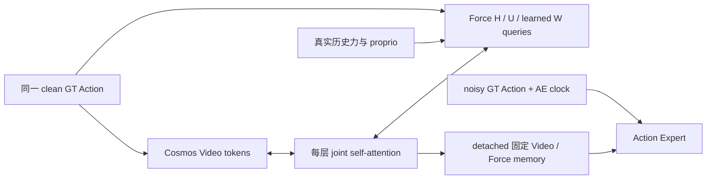

# Cosmos / ForceWM joint self-attention 对照

本分支 `codex/cosmos-force-joint-self-attention` 从 RealAction 的
`1f1756ee80ab113ea0ae4bea772a4f469bf0ca08` 建立，提供两路 WM 双向联合注意力，
用于检验“Force 与 Video 相互作用及 Force loss 回传会损害 Cosmos 预训练能力”的假设。
目前只有实现与 CPU 契约验证，没有本实验的 GPU 训练或质量结论。

## 对照边界

| 项目 | RealAction 基线 | 本分支 joint 模型 |
|---|---|---|
| Cosmos | 官方 robot/action-cond，28 层，宽 2048，16×128 heads | 相同官方初始化、原生 QK norm / RoPE / AdaLN / text cross-attention / 输出层 |
| Force | 28 层，宽 1280，FFN 4608，16 heads | 相同残差宽度、FFN、层数；Q/K/V 投影到 16×128，再投影回 1280 |
| WM 交互 | Force W 单向读取 detached 生成视频 | 每层一次 SDPA 对拼接的 Video、H、U、W 做联合注意力 |
| Video 能看到 Force | 否 | 所有有效 H/U/W；包括测量力历史与 learned future queries |
| Force loss → Cosmos | 生成记忆 detach，不能沿此路径回传 | 对独立生成结果的 clock=0 联合 refresh 可回传 |
| WM 的 Action | 同一份归一化真实 Action[0..31] | 相同；无 AE 输出、AE noisy Action 或 Action clock |
| AE 输入 | `(1−σ) Action_GT + σ Gaussian`，σ 逐样本采样 0..1 | 相同；保持原 scheduler shift=1、clock=1000σ |
| AE 记忆 | detached Video / Force，同一 diffusion 内固定 | 相同；独立当前帧 Video K/V 路径也相同 |

这里对齐的是原 RealAction 的 **σ∈[0,1]**，不是另外的 σ∈[0,0.1] 弱噪声实验。
训练配置由 `cosmos_forcewm_joint_4gpu_30k` 继承原 task，模型配置由
`cosmos_forcewm_joint` 继承原 model；展开后仅 `_target_` 和 `output_dir` 不同。

保持四卡/四 rank、B16、accum1、global64、AdamW lr=1e-4、betas=(0.9,0.95)、
weight_decay=0.01、warmup1500、cosine 到 30000、save5000、BF16/原生 FP32 区域、
ZeRO1、梯度裁剪1、全局/AE seed42、Force seed43、生成视频 seed44、控制投影 seed45，
VideoFM / ActionFM / ForceMSE 权重 1:1:1。检查 5000 checkpoint 时仍保留 30000 scheduler。

## 数据和梯度路径



每层先保留各自输入投影，再拼接 Q/K/V 做一次 softmax attention，最后拆分输出：
Video 走官方的 residual / AdaLN / text cross-attention / FFN，Force 走自己的 residual / FFN。
Force 的旧独立 self-attention 和单向 video cross-attention 被联合注意力替代，
没有留在优化器中的未用分支。共享模块保留与基线相同的随机初始化；新注意力投影使用独立的
RNG fork 初始化，不推进原本用于后续 AE memory 初始化的 RNG 状态。

直接 Force→Force mask 仍为 H 读 causal H、U 读 bidirectional U、W 读 H/U 和 causal W。
新增 Video↔全部有效 Force token 的边，因此经过多层后可以通过 Video 间接交换信息；
不能再声称保持原 H/U/W 的跨层严格隔离。无效 Force token 不能成为任何有效 query 的 K/V，
无效 query 仅有自身 sentinel，并在每层后清零。未来 W 是 32 个 learned queries，
一次预测 future wrench[1..32]；没有真实未来 wrench 输入、previous-wrench teacher 或 AR。

训练的 VideoFM 正常读取加噪目标视频进行监督。**ForceMSE 和 AE memory 来自另一条独立生成路径**：

1. 从独立当前帧 latent 和视频高斯噪声起步，以相同 clean Action 做 16 步 joint 视频生成；
   每步固定当前帧，整个 rollout 使用 no-grad。
2. 对生成 latent 做一次 clock=0 的 joint refresh。训练时该 pass 保持 autograd，
   ForceMSE 经它回传到 Cosmos，rollout 本身不展开反传。
3. 把此 refresh 的 Video / Force features detach 后交给 AE，AE 仍只重建 noisy Action。
   未来 Video / Force 标签以及它们的标签有效性掩码不参与生成路径。

生成视频不使用目标未来 latent。实际推理和训练 Force 路径的生成 seed、同一组 WM 输入一致时，
其计算流程一致。独立 observed-only Video K/V 始终只看当前帧，不使用联合 future features。

## 代价与可解释范围

联合方式改变 Force 注意力投影与参数量，不是严格等参数对照。Video 的预训练参数保持同样形状
与初始值，Force 残差/FFN 和 AE 几何不变。实际参数计数见下表；它们是模型结构计数，
不是显存或吞吐实测。

| 参数量 | RealAction | joint |
|---|---:|---:|
| 每个 Force block | 26,893,568 | 22,300,672 |
| 28 个 Force blocks 的差值 | — | −128,601,088 |
| ForceWM 整体 | 754,581,510 | 625,980,422 |
| 全模型 | 3,751,013,676 | 3,622,412,588 |

两组训练均有 19 次 Video pass：监督1、生成16、refresh1、独立当前帧1。
joint 在前18次同时执行 Force block，基线只在生成后执行一次 Force 网络；joint 的 refresh
还保留 Video 梯度图，因此不能沿用基线的时间/显存预算。正式运行须以新的实际四卡预检为准。

相对基线的结果反映整个“双向交互 + 梯度耦合”改动，不能单凭下降就归因于预训练物理理解被破坏。
如果需要进一步隔离梯度效应，应另作相同 joint 拓扑下的梯度阻断或冻结 Cosmos 对照。
本分支未擅自加入这些额外实验。

## 配置与后续入口

先在本分支的独立部署目录，用实际且已验证的资产路径展开配置；下面路径是待填写项：

```bash
PYTHONPATH=src /path/to/native/.venv/bin/python scripts/cosmos/resolve_config.py \
  --task cosmos_forcewm_joint_4gpu_30k \
  --text-cache /path/to/verified/reason1-cache \
  --feature-cache /path/to/verified/cosmos-feature-cache \
  --checkpoint /path/to/official/robot-action-cond.pt \
  --upstream /path/to/this-source/third_party/cosmos-predict2.5 \
  --output-dir /path/to/new-joint-run/training \
  --config-output /path/to/joint-resolved.yaml
```

解析器逐一核原始资产 SHA、缓存身份和源 pin，拒绝未填身份值。默认计划模式可查看实际三个阶段，
不会创建 run 目录或启动训练：

```bash
/path/to/native/.venv/bin/python scripts/cosmos/distributed_chunk.py \
  --config /path/to/joint-resolved.yaml \
  --run-root /path/to/new-joint-run \
  --native-python /path/to/native/.venv/bin/python
```

后续实际运行用同一入口显式 `--execute`，由平台提供真实 `TRAIN_JOB_ID`，先完成实际四卡
two-Adam/full-state-save 和独立 fresh 四卡恢复，再进入正式训练。
`binding.py` 对当前全部 Python source、实际配置和 pinned upstream 计算身份，旧基线 receipts
不能复用；dispatch 记录 `cosmos-force-joint-self-attention`。正式 run/output 必须独立。
旧 `scripts/resume/frozen_code.json` 仍属于旧实验，不是新分支的来源证明，也不用于新实验启动。

权重 schema 为 `fastwam-cosmos-force-joint-self-attention28-v1`，manifest schema 为
`cosmos-force-joint-self-attention28-v1`，记录联合拓扑、宽度和 refresh 梯度协议。
权重 load 与全状态 runtime manifest 均严格匹配，拒绝混载基线 v3。

## 后续公平评测

优先与原 RealAction 的**同一 5000 step**比较，不把不同步数混在一起。保留两组实际 source、
checkpoint SHA、原生日志、同 step loss 单点和末段同 steps 均值。相同数据缓存、划分、normalizer、
raw FP64 归一化、Action/Force masks 和严格 +1 对齐，两个 WM 均输入同一 clean GT Action。

复用五个完整训练 episode 0/12/24/36/49、129 窗（包括原119窗以及头尾补窗），逐窗重置观察条件，
固定相同 Video seed44/16步和 AE seed0/16步；AE 起点也须两组一致，默认都从原版 Gaussian 起步。
若另测 GT+σ0.1 的重建，两组同时使用相同起点，单列结果；不与 Gaussian 起点混比。
分别报告 Action 起点/去噪误差、Force 六通道和聚合误差、main/wrist 各自 PSNR 与实际预测视频。

这些是训练集条件生成/重建测试。它们不能单独证明自主策略、闭环表现、泛化或完整物理世界理解。
判断预训练能力是否受损需要额外保留的物理场景/视频评测集与合适的冻结/梯度对照。

## 已有验证

`PYTHONPATH=src python -m pytest tests/cosmos -q`：83 passed（包含15项 joint 测试）。
覆盖真实双向输入影响、ForceMSE→Cosmos 梯度、Video loss→Force 梯度、AE noise/clock 隔离、
未来标签隔离、padding、共享初始化、两次 Adam 后完整保存与下一步精确恢复、旧 schema 拒绝、
BF16/原生 FP32 无 autocast 和 gradient checkpointing 一致性。
这些使用缩小的官方 Cosmos 网络与合成数据，只证明代码契约，不是 GPU 实测。
